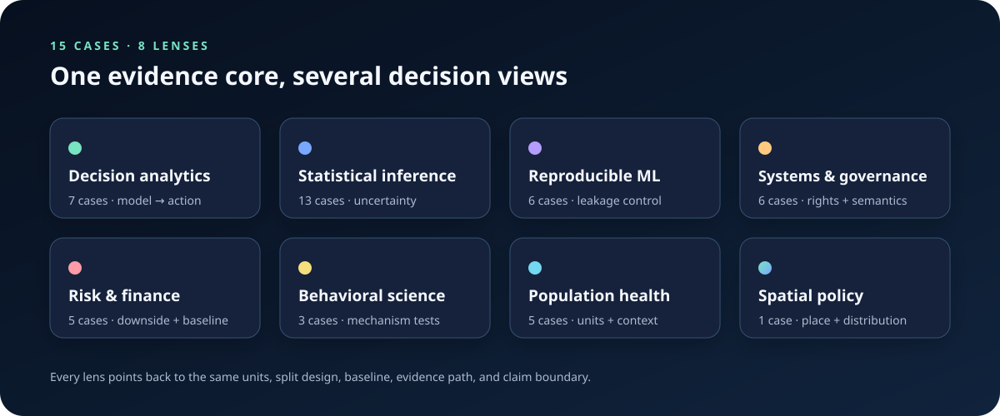
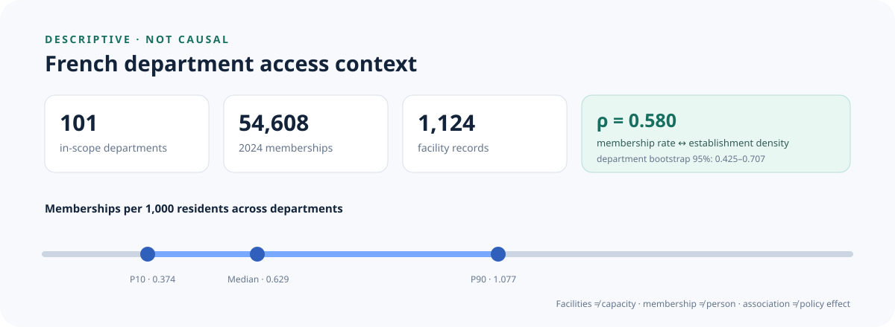
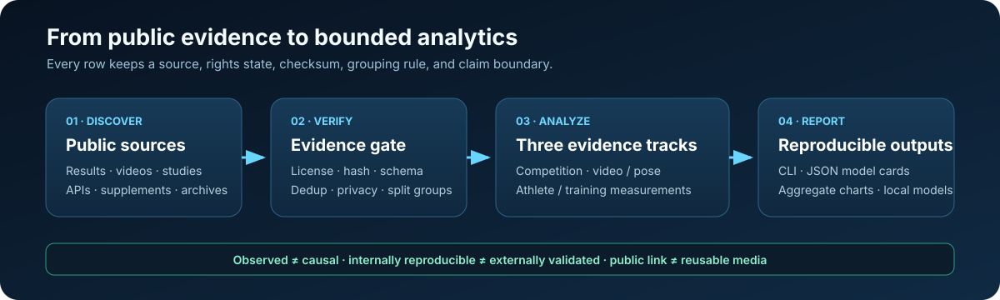

# PisteFlow Analytics

[](https://github.com/limingrui679-design/pisteflow-analytics/actions/workflows/ci.yml)
[](https://limingrui679-design.github.io/pisteflow-analytics/)
[](https://www.python.org/)
[](docs/CASE_STUDIES.md)
[](#evidence-contract)
[](LICENSE)

**Use past bouts to study what carries forward into the next fencing competition.**

Fencing results arrive as bouts, tournament rankings and updates published on different dates. PisteFlow reconstructs the order in which results became available, then tests ratings on later bouts. Analysts can compare performance across épée, foil and sabre or open a worked case on ranking movement, motion or access to clubs.

In its three-weapon Elo replay, PisteFlow updates ratings after each competition day so earlier predictions use only earlier results. On 16,365 held-out bouts from 2020, the ratings achieved an AUC of 0.817 and a log loss of 0.526, compared with 0.500 and 0.693 for a constant 50% prediction. [Inspect the evaluation](docs/CASE_STUDIES.md#three-weapon-elo)

[Evidence Studio](https://limingrui679-design.github.io/pisteflow-analytics/) ·
[Case guide](docs/CASE_STUDIES.md) · [Data atlas](docs/DATA_ATLAS.md) ·
[Reproducibility](docs/REPRODUCIBILITY.md) · [Contributing](CONTRIBUTING.md)


## Try it in 90 seconds — no data download

```bash
git clone https://github.com/limingrui679-design/pisteflow-analytics.git
cd pisteflow-analytics
python3.12 -m venv .venv && source .venv/bin/activate && python -m pip install -e .
pisteflow showcase list
pisteflow showcase show ranking-trajectory
pisteflow showcase list --status no-lift
```

The bundled catalog works from the installed wheel. It does not require raw media, private rows,
models, repository evidence files, or network access.

To audit every case against the repository:

```bash
pisteflow showcase audit --evidence-root .
```

## Fifteen cases, eight capability lenses



| Lens | What reviewers can inspect | Representative cases |
|---|---|---|
| Decision analytics | Model-to-action reasoning, strong baselines, bounded use | Elo, junior pool outcomes, ranking trajectories |
| Statistical inference | Chronology, grouping, uncertainty, negative results | Hot hand, strength, spatial bootstrap |
| Reproducible ML | Participant/video/identity isolation and package tests | Pose outcomes, MFAD actions, image identity |
| Data systems & governance | Rights, semantics, lineage, privacy, exclusions | Source registry, referee-label diagnostic |
| Risk & finance | Downside-aware comparisons and transparent heuristics | Elo calibration, seed rule, persistence rule |
| Behavioral science | Mechanism testing without causal overreach | Hot hand, gaze, cognition-ready sources |
| Population health | Correct units, heterogeneous health evidence, equity context | Strength, accessibility matrix, spatial access |
| Spatial policy | Place-based distribution and implementation limits | French department access context |

The public repository stays school-neutral. The capability lenses organize engineering evidence; they
do not rename the same project for different audiences.

## Results that survive their baselines

| Case | Evaluation | Model / analysis | Credible comparison | Evidence status |
|---|---:|---:|---:|---|
| Three-weapon pre-day Elo | 16,365 untouched bouts | AUC 0.817; log loss 0.526 | Uninformative AUC 0.500; log loss 0.693 | Lift |
| Foil pose outcomes | 9,328 OOF clips / 1,332 videos | Balanced accuracy 0.465; macro-F1 0.464 | Majority 0.333 / 0.216 | Lift |
| MFAD action recognition | 928 sequences / 27 held-out participants | Balanced accuracy 0.794; macro-F1 0.798 | Majority 0.327 / 0.244 | Lift |
| Ranking trajectory | 16,687 chronological transitions | MAE 2.207 places | Persistence MAE 2.153 | **No lift** |
| Static lunge velocity | 45 participant-held-out predictions | RMSE 0.179 m/s | Mean RMSE 0.177 m/s | **No lift** |
| Advance lunge velocity | 45 participant-held-out predictions | RMSE 0.449 m/s | Mean RMSE 0.477 m/s | Small lift; limited N |
| Junior pool outcomes | 37,813 untouched bouts | Accuracy 0.8474; AUC 0.9167 | Higher seed 0.8471 / 0.9167 | **No material lift** |
| Sabre gaze / touch | 379 touches / 10 held-out participants | AUC 0.578; log loss 0.691 | Phase-only 0.498 / 0.685 | **No robust lift** |
| Hot-hand additions | 161 bouts / 13 pools | Recent form worsens point metrics | Rating-only AUC 0.868 | **No lift; intervals span zero** |
| Referee-label diagnostic | 395 clips / 55 groups | Balanced accuracy 0.536; log loss 1.072 | 0.333 / 1.024 | Mixed; semantics unverified |
| Pose-semantics diagnostic | 28,727 sequences / 28,312 groups | AUC 0.574 | Empirical AUC 0.500 | Signal, undefined target |
| New Zealand Elo replication | 4,706 untouched 2026 bouts | Accuracy 0.715; AUC 0.799 | Uninformative AUC 0.500 | Regional replication |

Exact folds, confusion matrices, seeds, hashes, exclusions, and boundaries live in
[`reports/model-cards/`](reports/model-cards/). Positive, negative, mixed, diagnostic, and replication
results are all retained.

## A new place-based access case



The analysis joins official French 2024 department-age-sex membership counts, the 2024 active-club
panel, population denominators, and 1,124 fencing-related facility records updated through 2026.

- 101 in-scope departments; 54,608 memberships; 749 active establishments.
- Membership rate versus active-establishment density: Spearman ρ 0.580, department-bootstrap 95%
  interval 0.425–0.707.
- Membership rate versus listed-equipment density: ρ 0.486, interval 0.308–0.635.
- Female membership share versus establishment density: ρ 0.096, interval −0.116–0.299.
- Missing facility booleans remain missing; overseas and non-France geographies follow the official
  in-scope flag.

These are descriptive department associations. Memberships are not unique people, facilities are not
capacity or availability, and the time-mismatched snapshots cannot establish access barriers or policy
effects. See the [aggregate analysis card](reports/model-cards/france-spatial-access.json).

## From public source to bounded decision



```text
source registry ─→ pinned adapter ─→ local normalized table ─→ identity-safe split
       │                  │                    │                         │
 rights + state      schema + hash      unit + provenance       people/video/time
       └──────────────────────────────→ aggregate evidence ←────────────┘
                                              │
                                    case catalog + claim boundary
                                              │
                                        CLI + web demo
```

The [architecture guide](docs/ARCHITECTURE.md) defines each boundary and failure mode.

## Run the analyses

Install development and source extras:

```bash
python -m pip install -e '.[dev,video,collectors,ffd]'
```

Run an analysis after preparing its named local input:

```bash
pisteflow analysis competition-elo
pisteflow analysis foil-pose-outcomes
pisteflow analysis mfad-actions
pisteflow analysis strength-velocity
pisteflow analysis ranking-trajectory
pisteflow analysis osf-pool-outcomes
pisteflow analysis sabre-eye-outcomes
pisteflow analysis hot-hand-validation
pisteflow analysis france-spatial-access
```

Start with bounded public downloads:

```bash
# 111 fencing clips selectively extracted from a pinned UCF101 archive.
pisteflow sources ucf101-discover
pisteflow sources ucf101-download

# Manually curated Commons videos with per-file open licenses.
pisteflow sources commons-discover
pisteflow sources commons-download --workers 2

# Official French licence, club, population, and facility context.
pisteflow sources france-fencing-licences-fetch
pisteflow sources france-fencing-infrastructure-fetch
```

Use `pisteflow sources --help` for the complete catalog. Large, unknown-license,
privacy-sensitive, or non-redistributable inputs stay local by design.

## Three-weapon evidence scale

| Evidence family | Epee | Foil | Sabre |
|---|---:|---:|---:|
| USA national bout results | 135,463 | 132,226 | 106,854 |
| Frozen AskFRED v1 outcome-eligible bouts | 1,805,692 | 1,924,073 | 1,169,003 |
| FencingTracker 2024 outcome-eligible bouts | 101,492 | 89,598 | 70,395 |
| Junior World Cup pool bouts | 60,817 | 52,201 | 45,634 |
| Elite strength / lunge participants | 17 | 12 | 16 |
| Open Commons videos | 11 | 10 | 27 |
| Title-inferred focused public-video links | 8,871 | 8,522 | 8,917 |
| Single-weapon Open Images positives | 93 | 104 | 77 |
| 2007–2016 top-200 ranking memberships | 8,000 | 8,000 | 8,000 |

Counts within a row share one unit; counts across rows do not. Multi-weapon participants may appear in
more than one membership column. See [`docs/DATA_ATLAS.md`](docs/DATA_ATLAS.md) for the full matrix.

## Repository map

```text
src/pisteflow/sources/       acquisition, normalization, hashing, privacy minimization
src/pisteflow/analysis/      grouped, chronological, and descriptive analyses
src/pisteflow/resources/     wheel-bundled case catalog
data/registry/               rights decisions, source rules, explicit exclusions
data/manifests/              aggregate source and data-quality evidence
reports/model-cards/         aggregate evaluation evidence; no row-level predictions
docs/showcase/               dependency-free interactive Evidence Studio
tests/                       schema, identity, split, denominator, metric, and catalog checks
```

## Evidence contract

- **Observed is not causal.** Strength, gaze, ranking, sleep, injury, facility, and participation
  records do not establish training or policy effects.
- **Internally reproducible is not externally validated.** No result is federation certification,
  clinical validation, independent domain review, organizational adoption, or measured user impact.
- **Publicly viewable is not reusable.** Rights state is recorded separately from discoverability;
  restricted and unknown-license rows remain link-only or local-only.
- **A row is not always a person.** Memberships, bouts, touches, clips, frames, facilities, periods,
  and repeated measurements retain their own units.
- **A mirror is not a new sample.** Exact repeats, source identities, transformations, participants,
  videos, competitions, and dates are grouped according to the intended claim.
- **A more complex model is not automatically better.** Persistence, seed rules, phase-only models,
  and empirical probabilities remain visible comparisons.
- **Missing labels stay missing.** Generic fencing, swordplay, pose, and undocumented targets are not
  silently relabeled as weapon, referee, or clinical truth.

## Verify, contribute, and cite

```bash
ruff check .
mypy
pytest -q
python scripts/sync_showcase.py --check
pisteflow showcase audit --evidence-root .
python -m build
python scripts/audit_distribution.py dist
```

CI runs these gates on Python 3.11 and 3.12, verifies all 23 evidence-file hashes and generated case
surfaces, and smoke-tests that the wheel contains all 15 cases.
Read [CONTRIBUTING.md](CONTRIBUTING.md), [SECURITY.md](SECURITY.md), and
[CHANGELOG.md](CHANGELOG.md) before proposing a source or analysis.

Software citation metadata are available in [`CITATION.cff`](CITATION.cff). Analysis users should
also cite each original source named in the relevant manifest. Code is released under the
[MIT License](LICENSE); upstream data and media retain their own terms.
