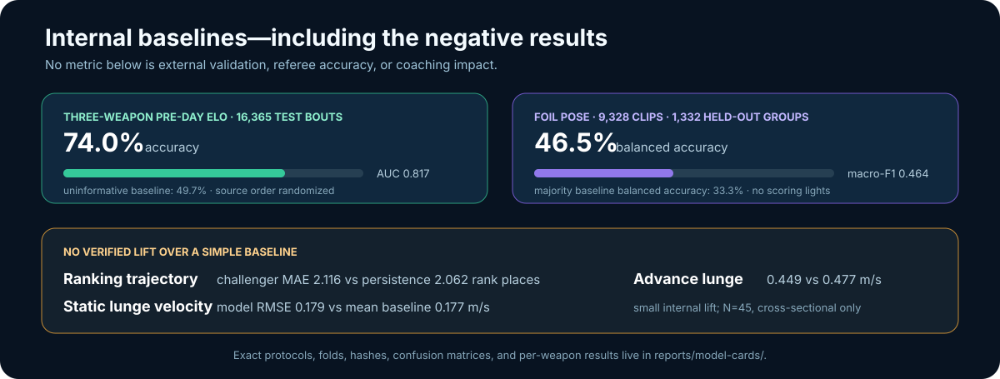

# PisteFlow Analytics

[](https://www.python.org/)
[](#three-weapon-coverage)
[](#claim-boundaries)
[](LICENSE)

**A Python-first evidence pipeline for real fencing competition, video / pose, and athlete
training data—covering epee, foil, and sabre without mixing incompatible units or inflating
validation claims.**


## What is implemented

| Track | Current output | Leakage / evidence control |
|---|---|---|
| Competition | Pre-day three-weapon Elo replay over 374,088 decisive bouts | Source always stores winner left; evaluation orientation is hash-randomized and same-day updates are delayed |
| Video / pose | Foil pose-outcome baseline over 9,328 real 75-frame clips | Five folds hold out all clips from each of 1,332 source videos; scoring lights and duplicate windows are excluded |
| Athlete | Strength-to-lunge nested cross-validation across 45 elite fencers | Participant-level outer folds; both velocity outcomes are removed from predictors |
| Ranking | Chronological next-snapshot model over 63,871 short-horizon transitions | Target-date holdout from 2020 onward; compared with current-rank persistence |
| Acquisition | 103 unique source records with adapters, manifests, hashes, exclusion decisions, and rights states | Raw media and restricted rows remain outside Git; link-only is never labelled acquired |
| Image union | 20,240 checksummed rows resolve to 19,906 conservative exact/source-identity groups | 311 exact duplicate extras and 23 additional identity-linked extras are grouped; dHash near-neighbors are review candidates, never automatic merges |


## Honest internal baselines

| Analysis | Evaluation set | Model | Simple baseline | Result |
|---|---:|---:|---:|---|
| Three-weapon pre-day Elo | 16,365 bouts, Feb–Mar 2020 | 74.0% accuracy; AUC 0.817; log loss 0.526 | 49.7%; AUC 0.500; log loss 0.693 | Verified internal lift |
| Foil pose outcomes | 9,328 OOF clips / 1,332 groups | 46.5% balanced accuracy; macro-F1 0.464 | 33.3%; macro-F1 0.216 | Verified internal lift |
| Ranking trajectory | 16,687 transitions, 2020–2023 | MAE 2.207 rank places | Persistence MAE 2.153 | **No lift** |
| Static lunge velocity | 45 participants, nested CV | RMSE 0.179 m/s | Mean RMSE 0.177 m/s | **No lift** |
| Advance lunge velocity | 45 participants, nested CV | RMSE 0.449 m/s | Mean RMSE 0.477 m/s | Small internal lift; N is limited |
| Junior pool outcomes | 37,813 bouts from 2025-2026 | 84.7% accuracy; AUC 0.917; log loss 0.371 | Lower-seed pick: 84.7%; AUC 0.917 | No material discrimination lift over the seed heuristic |
| Sabre eye / touch outcomes | 379 touches / 10 participant-held-out folds | 55.4% accuracy; AUC 0.578; log loss 0.691 | Phase-only: 53.8%; AUC 0.498; log loss 0.685 | **No robust lift**; association-only result |



Exact folds, confusion matrices, per-weapon metrics, seeds, hashes, and negative results are in
[`reports/model-cards/`](reports/model-cards/).

## Install and verify

```bash
python3.12 -m venv .venv && source .venv/bin/activate && python -m pip install -e '.[dev,video,collectors]' && pytest -q
```

Run the evidence analyses after acquiring their named local inputs:

```bash
pisteflow analysis competition-elo
pisteflow analysis foil-pose-outcomes
pisteflow analysis strength-velocity
pisteflow analysis ranking-trajectory
pisteflow analysis osf-pool-outcomes
pisteflow analysis sabre-eye-outcomes
```

Two bounded public downloads:

```bash
# Selectively extracts only 43.0 MB / 111 fencing clips from a pinned 6.96 GB UCF101 ZIP.
pisteflow sources ucf101-discover
pisteflow sources ucf101-download

# Downloads only the 48 manually curated Commons rows with verified open licenses.
pisteflow sources commons-discover
pisteflow sources commons-download --workers 4

# Large three-weapon results plus privacy-minimized athlete evidence.
pisteflow sources osf-three-weapons-fetch
pisteflow sources osf-sabre-eye-tracking-fetch
pisteflow sources osf-fencer-psychology-fetch
pisteflow sources plos-fencer-cognition-fetch
pisteflow sources plos-elite-backpain-fetch
pisteflow sources peerj-tdcs-fetch
pisteflow sources frontiers-handedness-2021-fetch
pisteflow sources relative-age-combat-fetch
pisteflow sources korea-gkl-wheelchair-fetch
pisteflow sources riposte-adapted-fencing-fetch
pisteflow sources brazilian-ssbs-fencing-fetch

# License-screened still-image discovery, acquisition, and cross-source deduplication.
pisteflow sources commons-images-discover --max-depth 3
pisteflow sources commons-images-download --workers 2
pisteflow sources openverse-fencing-discover
pisteflow sources openverse-fencing-download
pisteflow sources image-union-audit
```

Use `pisteflow sources --help` for the complete acquisition catalog. Large, unknown-license,
privacy-sensitive, or non-redistributable inputs are kept local by design.

## Three-weapon coverage

| Evidence family | Epee | Foil | Sabre |
|---|:---:|:---:|:---:|
| USA national bout results | 135,463 | 132,226 | 106,854 |
| Frozen AskFRED v1 outcome-eligible bouts | 1,805,692 | 1,924,073 | 1,169,003 |
| FencingTracker 2024 outcome-eligible bouts | 101,492 | 89,598 | 70,395 |
| Junior World Cup pool bouts | 60,817 | 52,201 | 45,634 |
| Paris 2024 individual + team events | ✓ | ✓ | ✓ |
| NCAA championship pool bouts | ✓ | ✓ | ✓ |
| Elite strength / lunge participants | 17 | 12 | 16 |
| Competition-site lunge-impact memberships | 53 | 14 | 12 |
| 2019 youth rank 1–20 participants | 157 | 151 | 97 |
| Korean wheelchair-fencing placement rows | 159 | 171 | 128 |
| Psychology survey participants | 68 | 4 | 6 |
| Open Commons videos | 11 | 10 | 27 |
| Title-inferred focused public-video links | 8,871 | 8,522 | 8,917 |
| Single-weapon Open Images positives | 93 | 104 | 77 |
| National-level eye-tracking participants | — | — | 10 main + 14 pilot labels |
| 2007-2016 top-200 ranking memberships | 8,000 | 8,000 | 8,000 |
| Chronological ranking trajectories | ✓ | ✓ | ✓ |

Counts within a row share one unit; counts across rows do not. Multi-weapon participants may appear
in more than one membership column. The full source matrix is
[`docs/DATA_ATLAS.md`](docs/DATA_ATLAS.md).

## Repository map

```text
src/pisteflow/sources/     acquisition, normalization, hashing, privacy minimization
src/pisteflow/analysis/    grouped and chronological internal baselines
data/manifests/            committed source inventories and aggregate summaries
data/registry/             rights decisions, source rules, and explicit exclusions
reports/model-cards/       aggregate evaluation evidence; no row-level predictions
docs/                      data atlas, data policy, and visual architecture
tests/                     schema, deduplication, split, parsing, and metric checks
```

## Claim boundaries

- **Observed is not causal.** Cross-sectional strength, ranking, sleep, injury, and physiology
  records do not establish training effects or prescriptions.
- **Internally reproducible is not externally validated.** No result here is federation
  certification, referee accuracy, organizational adoption, or measured coaching impact.
- **Publicly viewable is not reusable.** Unlicensed tournament footage stays link-only; mixed-rights
  media stays local; per-file open licenses retain attribution.
- **A row is not always a person.** Rankings, athlete-event memberships, periods, relays, frames,
  clips, and repeated measurements retain their own units.
- **A mirror is not a new sample.** Augmentations, exact repeats, source-video windows, and overlapping
  historical snapshots are grouped or excluded before evaluation.
- **Missing labels stay missing.** Generic fencing, swordplay, or pose data are not silently mapped to
  epee, foil, or sabre.

Read [`docs/DATA_POLICY.md`](docs/DATA_POLICY.md) for distribution rules and
[`data/registry/source-exclusions.yml`](data/registry/source-exclusions.yml) for sources that were
found but deliberately not counted.
