# Architecture

PisteFlow is an evidence pipeline, not one monolithic model. Each layer narrows what downstream code
is allowed to claim, and every public result remains traceable to a source state and evaluation
contract.

```mermaid
flowchart LR
    A["Source registry<br/>rights + privacy + state"] --> B["Source adapters<br/>pin + parse + normalize"]
    B --> C["Local data layer<br/>raw + processed + hashes"]
    C --> D["Identity controls<br/>people + videos + dates + duplicates"]
    D --> E["Analysis contracts<br/>baseline + split + uncertainty"]
    E --> F["Aggregate evidence<br/>model cards + manifests"]
    F --> G["Case catalog<br/>capability + result + boundary"]
    G --> H["CLI + Evidence Studio<br/>zero-data review"]
```



## Layer contracts

| Layer | Public responsibility | Deliberately local or unresolved |
|---|---|---|
| Registry | Canonical URL, status, rights decision, exclusions | Credentials and unstated permissions |
| Adapter | Schema validation, pinned bytes or identifiers, normalization | Restricted archives and raw media |
| Data | Stable units, pseudonymous keys, hashes, source-specific tables | Sensitive rows and large artifacts |
| Identity | Exact hashes, source identities, grouping keys, time boundaries | Unverified semantic equivalence |
| Analysis | Feature policy, split design, baseline, uncertainty, negative results | Row-level predictions and fitted models |
| Evidence | Aggregate counts, metrics, exclusions, claim boundary | External validation that has not happened |
| Showcase | Fifteen curated cases across eight capability lenses | School-specific marketing or fabricated impact |

## Package boundaries

```text
src/pisteflow/
├── sources/          independent acquisition and normalization adapters
├── analysis/         reusable grouped, chronological, and descriptive analyses
├── training/         generic training components
├── video/            media feature extraction
├── resources/        package-bundled zero-data case catalog
├── commands/         lightweight command groups
├── distribution.py  source/wheel size, scope, and archive-safety audit
├── provenance.py     canonical JSON, hashing, and atomic writes
├── showcase.py       catalog schema, filters, audit, and export
├── entrypoint.py      fast dispatch for zero-data commands
└── cli.py            user-facing orchestration only
```

The source adapters do not import analyses. Analyses accept prepared tables and can be tested with
synthetic data. The showcase does not import local data and therefore works from an installed wheel.
Repository evidence checking is optional at runtime but mandatory in CI.

## Evidence states

PisteFlow keeps these states distinct:

1. **Discovered** — a URL or record exists.
2. **Rights-screened** — reuse and redistribution have been evaluated.
3. **Acquired** — bytes are present locally and, where permitted, hashed.
4. **Prepared** — units and schemas pass source-specific validation.
5. **Internally evaluated** — a declared split and baseline have produced reproducible metrics.
6. **Replicated** — a method has been rerun in another internal dataset or region.
7. **Externally validated** — independent domain or method review exists.
8. **Adopted / impactful** — a real organization or user outcome has been verified.

The public repository currently contains evidence through states 5–6 for selected cases. It does not
silently advance a case to states 7–8.

## Failure behavior

- Schema drift raises an error instead of coercing a new source shape.
- A missing or changed checksum stops pinned-source preparation.
- Missing booleans remain missing; they are not counted as false.
- Duplicate IDs or cross-group overlap fail relevant preparation or evaluation steps.
- Case catalog drift between the Python package and static demo fails CI.
- Changed evidence hashes, escaped evidence paths, or model cards without a claim boundary fail
  `pisteflow showcase audit`.
- Oversized or unsafe distributions, excluded data payloads, or missing package review surfaces fail
  the distribution audit.

## Extension points

New sources belong in `src/pisteflow/sources/` with registry entries and parser tests. New analyses
belong in `src/pisteflow/analysis/` with synthetic split and denominator tests. A new showcase case is
the final step: it must reference existing evidence, state a decision use, and define what the result
cannot prove.
